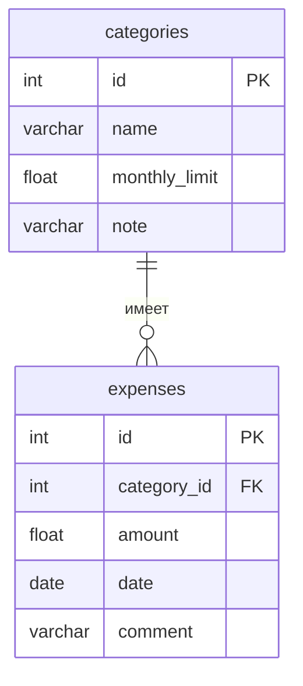

# Учёт расходов

Тема №17: **Учёт расходов**. Личный бюджет по категориям трат.

|                          |                                                      |
| ------------------------ | ---------------------------------------------------- |
| Главная сущность         | Категория (название, месячный лимит)                 |
| Связанная сущность (1:N) | Трата (сумма, дата, комментарий)                     |
| Фишка                    | лимит категории на месяц, статистика трат по месяцам |
| Стек                     | Python, FastAPI, данные в памяти                     |

## Как запустить

```
git clone https://github.com/dimakhamin-hue/backend-labs.git
cd backend-labs
pip3 install -r requirements.txt
python3 -m uvicorn main:app --port 8000
```

Сервис работает на `http://localhost:8000`. Запросы для демонстрации лежат в `requests.http`.

## Эндпоинты

| Метод  | Путь                   | Что делает                       | Ответ                               |
| ------ | ---------------------- | -------------------------------- | ----------------------------------- |
| GET    | `/health`              | Проверка, что сервис жив         | 200 `{"status":"ok"}`               |
| POST   | `/api/categories`      | Создать категорию                | 201 и объект с `id`; 400 при ошибке |
| GET    | `/api/categories`      | Список (`?limit=&offset=&name=`) | 200; 400 при неверных параметрах    |
| GET    | `/api/categories/{id}` | Получить одну категорию          | 200; 404                            |
| PATCH  | `/api/categories/{id}` | Изменить                         | 200; 400; 404                       |
| DELETE | `/api/categories/{id}` | Удалить                          | 204; 404                            |

Ошибки валидации: `400 {"error": "текст", "field": "имя поля"}`.

## ER-диаграмма


