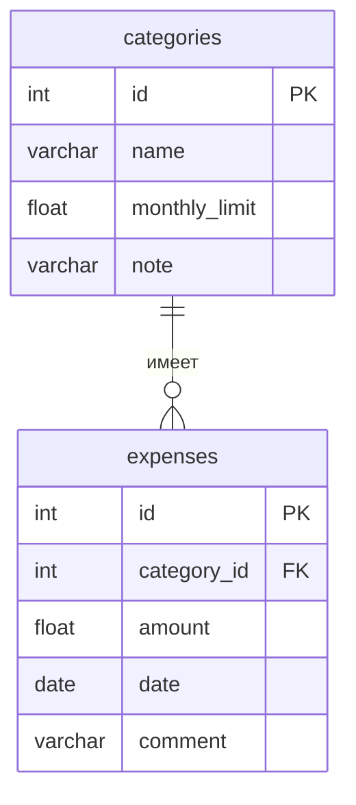

# Учёт расходов

Тема №17: **Учёт расходов**. Личный бюджет по категориям трат.

|                          |                                                      |
| ------------------------ | ---------------------------------------------------- |
| Главная сущность         | Категория (название, месячный лимит)                 |
| Связанная сущность (1:N) | Трата (сумма, дата, комментарий)                     |
| Фишка                    | лимит категории на месяц, статистика трат по месяцам |
| Стек                     | Python, FastAPI, SQLite                              |

## Как запустить

```
git clone https://github.com/dimakhamin-hue/backend-labs.git
cd backend-labs
pip3 install -r requirements.txt
python3 -m uvicorn main:app --port 8000
```

Сервис работает на `http://localhost:8000`. Запросы для демонстрации лежат в `requests.http`.

База данных: SQLite. Файл `budget.db` создаётся сам из `schema.sql` при старте. Путь можно задать переменной окружения `DB_PATH` (см. `.env.example`). Тестовые данные: `python3 seed.py`.

## Эндпоинты

| Метод  | Путь                            | Что делает                                    | Ответ                                    |
| ------ | ------------------------------- | --------------------------------------------- | ---------------------------------------- |
| GET    | `/health`                       | Проверка, что сервис жив                      | 200 `{"status":"ok"}`                    |
| POST   | `/api/categories`               | Создать категорию                             | 201 и объект с `id`; 400 при ошибке      |
| GET    | `/api/categories`               | Список (`?limit=&offset=&name=&q=&sort=`)     | 200; 400 при неверных параметрах         |
| GET    | `/api/categories/{id}`          | Получить одну категорию                       | 200; 404                                 |
| PATCH  | `/api/categories/{id}`          | Изменить                                      | 200; 400; 404                            |
| DELETE | `/api/categories/{id}`          | Удалить (траты удаляются каскадом)            | 204; 404                                 |
| POST   | `/api/categories/{id}/expenses` | Добавить трату                                | 201; 400; 404; 409 при превышении лимита |
| GET    | `/api/categories/{id}/expenses` | Список трат категории                         | 200; 404                                 |
| GET    | `/api/expenses/stats`           | Сумма трат по месяцам                         | 200                                      |

Ошибки валидации: `400 {"error": "текст", "field": "имя поля"}`.

## ER-диаграмма



## Индекс

Индекс `idx_expenses_category_date` по `(category_id, date)` ускоряет частый запрос: траты категории за месяц (по нему проверяется лимит).

```
EXPLAIN QUERY PLAN SELECT * FROM expenses WHERE category_id = 1 AND substr(date,1,7) = '2026-10';

QUERY PLAN
`--SEARCH expenses USING INDEX idx_expenses_category_date (category_id=?)
```